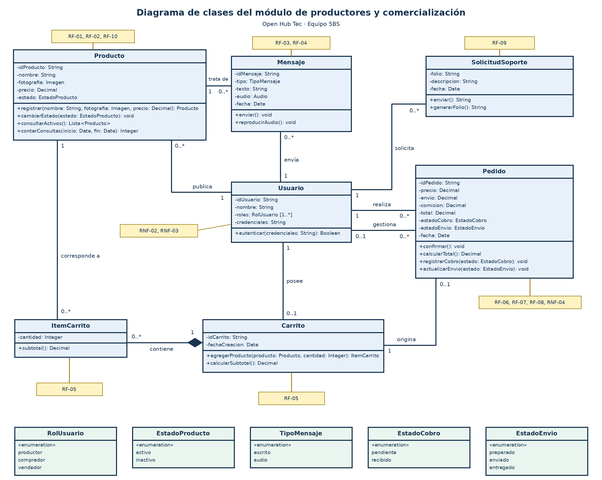

# Entrega · Práctica 9

**Equipo:** Grupo 4  
**Módulo del Hub:** Productores y comercialización  
**Organización:** Open Hub Tec · Instituto Tecnológico de Tlaxiaco

## 1. Clases identificadas

Las clases se identificaron a partir de los sustantivos del DRS. El modelo cubre la publicación de productos, los mensajes de compradores, el carrito, la confirmación y seguimiento de pedidos y las solicitudes de asistencia.

| Clase | Sustantivo del DRS | Requisito |
| --- | --- | --- |
| Usuario | Productor, comprador y vendedor | RNF-02; RNF-03 |
| Producto | Ficha de producto | RF-01; RF-02; RF-10 |
| Mensaje | Mensaje escrito o de audio | RF-03; RF-04 |
| Carrito | Carrito de compra | RF-05 |
| ItemCarrito | Producto y cantidad dentro del carrito | RF-05 |
| Pedido | Pedido confirmado | RF-06; RF-07; RF-08; RNF-04 |
| SolicitudSoporte | Solicitud de asistencia | RF-09 |

## 2. Atributos y tipos

Cada atributo se declara con su tipo. Los importes usan Decimal y los estados usan enumeraciones para limitar los valores admitidos por el modelo.

| Clase | Atributo y tipo | Descripción |
| --- | --- | --- |
| Usuario | idUsuario: String | Identificador único. |
| Usuario | nombre: String | Nombre de la persona. |
| Usuario | roles: RolUsuario [1..*] | Uno o más roles asignados a una misma persona. |
| Usuario | credenciales: String | Credenciales de acceso, guardadas de forma protegida (RNF-02, RNF-03). |
| Producto | idProducto: String | Identificador único. |
| Producto | nombre: String | Nombre del producto (RF-01). |
| Producto | fotografia: Imagen | Fotografía del producto (RF-01). |
| Producto | precio: Decimal | Precio en MXN con dos decimales (RF-01, RNF-04). |
| Producto | estado: EstadoProducto | Activo o inactivo; solo los activos aparecen en el catálogo público (RF-02). |
| Mensaje | idMensaje: String | Identificador único. |
| Mensaje | tipo: TipoMensaje | Escrito o audio. |
| Mensaje | texto: String | Contenido del mensaje escrito (RF-03). |
| Mensaje | audio: Audio | Grabación del mensaje de audio (RF-04). |
| Mensaje | fecha: Date | Fecha y hora de envío. |
| Carrito | idCarrito: String | Identificador único. |
| Carrito | fechaCreacion: Date | Fecha de creación del carrito. |
| ItemCarrito | cantidad: Integer | Cantidad elegida del producto (RF-05). |
| Pedido | idPedido: String | Identificador único. |
| Pedido | precio: Decimal | Importe de los productos, en MXN (RNF-04). |
| Pedido | envio: Decimal | Importe de envío, capturado o confirmado por el vendedor (RF-06). |
| Pedido | comision: Decimal | Comisión aplicable, capturada o confirmada por el vendedor (RF-06). |
| Pedido | total: Decimal | Precio + envío + comisión. |
| Pedido | estadoCobro: EstadoCobro | Pendiente o recibido (RF-07). |
| Pedido | estadoEnvio: EstadoEnvio | Preparado, enviado o entregado (RF-08). |
| Pedido | fecha: Date | Fecha del pedido. |
| SolicitudSoporte | folio: String | Folio visible para el usuario (RF-09). |
| SolicitudSoporte | descripcion: String | Descripción del problema. |
| SolicitudSoporte | fecha: Date | Fecha de la solicitud. |

## 3. Operaciones

Las operaciones representan las acciones de los requisitos. La tabla muestra la firma, el tipo de retorno y la función que cumple cada operación.

| Clase | Operación | Descripción |
| --- | --- | --- |
| Usuario | autenticar(credenciales: String): Boolean | Verifica la sesión; sin ella se niega el acceso a datos privados (RNF-02). |
| Producto | registrar(nombre: String, fotografia: Imagen, precio: Decimal): Producto | Crea la ficha y la agrega al catálogo del productor (RF-01). |
| Producto | cambiarEstado(estado: EstadoProducto): void | Activa o desactiva la ficha (RF-02). |
| Producto | consultarActivos(): Lista<Producto> | Devuelve las fichas activas para la vista pública (RF-02). |
| Producto | contarConsultas(inicio: Date, fin: Date): Integer | Cuenta los mensajes recibidos por el producto en el periodo elegido (RF-10). |
| Mensaje | enviar(): void | Entrega el mensaje al productor, asociado al producto consultado (RF-03, RF-04). |
| Mensaje | reproducirAudio(): void | Reproduce el audio en la conversación del productor (RF-04). |
| Carrito | agregarProducto(producto: Producto, cantidad: Integer): ItemCarrito | Registra el producto y la cantidad elegida (RF-05). |
| Carrito | calcularSubtotal(): Decimal | Suma los subtotales de sus ítems. |
| ItemCarrito | subtotal(): Decimal | Precio del producto por la cantidad. |
| Pedido | confirmar(): void | Confirma si el carrito tiene al menos un ítem y se han definido los importes (RF-06). |
| Pedido | calcularTotal(): Decimal | Calcula el total y lo presenta desglosado (RF-06). |
| Pedido | registrarCobro(estado: EstadoCobro): void | Guarda el estado de cobro (RF-07). |
| Pedido | actualizarEnvio(estado: EstadoEnvio): void | Actualiza el estado del pedido (RF-08). |
| SolicitudSoporte | enviar(): String | Registra la solicitud y devuelve el folio (RF-09). |
| SolicitudSoporte | generarFolio(): String | Genera el folio único de la solicitud. |

## 4. Encapsulamiento y visibilidad

Los atributos son privados (−) para proteger el estado interno de los objetos. Las operaciones son públicas (+) porque los casos de uso las invocan. Por ejemplo, Pedido actualiza su estado de cobro mediante registrarCobro(estado: EstadoCobro).

## 5. Asociaciones y multiplicidad

Cada fila indica cuántas instancias pueden participar en cada extremo. Por ejemplo, un comprador puede realizar 0..* pedidos y cada pedido corresponde a un comprador.

| Clase A | Asociación | Clase B | Multiplicidad A | Multiplicidad B | Regla |
| --- | --- | --- | --- | --- | --- |
| Usuario | publica | Producto | 1 | 0..* | Cada producto lo publica un productor. |
| Usuario | envía | Mensaje | 1 | 0..* | Cada mensaje tiene un remitente. |
| Mensaje | trata de | Producto | 0..* | 1 | Cada mensaje se refiere a un producto. |
| Usuario | posee | Carrito | 1 | 0..1 | Cada carrito pertenece a un comprador. |
| Carrito | contiene | ItemCarrito | 1 | 0..* | Cada ítem pertenece a un carrito. Un carrito puede iniciar vacío. |
| ItemCarrito | corresponde a | Producto | 0..* | 1 | Cada ítem se refiere a un producto. |
| Carrito | origina | Pedido | 1 | 0..1 | Cada pedido se origina en un carrito. |
| Usuario | realiza | Pedido | 1 | 0..* | Cada pedido corresponde a un comprador. |
| Usuario | gestiona | Pedido | 0..1 | 0..* | El modelo admite pedidos sin vendedor asignado. |
| Usuario | solicita | SolicitudSoporte | 1 | 0..* | Cada solicitud pertenece a un usuario. |

## 6. Agregación, composición y herencia

Carrito e ItemCarrito tienen una relación de composición. El rombo relleno se ubica en Carrito porque el ítem pertenece a un carrito y depende de él para existir. Producto se vincula con ItemCarrito por una asociación simple porque el producto puede existir fuera del carrito. Los perfiles de comprador, productor y vendedor se representan como roles de Usuario.

## 7. Trazabilidad

La matriz vincula cada clase con sus requisitos del DRS y las referencias a procesos documentadas para el módulo. Los identificadores P-01 a P-06 corresponden a la numeración usada en el reporte del equipo.

| Clase | Requisito | Proceso | Función del DRS |
| --- | --- | --- | --- |
| Usuario | RNF-02; RNF-03 | Transversal | Control de acceso; Comunicación segura |
| Producto | RF-01; RF-02; RF-10 | P-01; P-02; P-06 | Registrar producto; Consultar catálogo; Consultar estadísticas |
| Mensaje | RF-03; RF-04 | P-03 | Enviar mensaje; Enviar audio |
| Carrito | RF-05 | P-04 | Agregar al carrito |
| ItemCarrito | RF-05 | P-04 | Agregar al carrito |
| Pedido | RF-06; RF-07; RF-08; RNF-04 | P-04; P-05 | Confirmar pedido; Registrar cobro; Actualizar estado de pedido |
| SolicitudSoporte | RF-09 | P-06 | Solicitar asistencia |

## 8. Diagrama y notación UML

El proyecto de Enterprise Architect disponible en la rama se encuentra en [modelo/OpenHub-5BS.eap](../modelo/OpenHub-5BS.eap).

## 9. Trabajo en equipo

| Integrante | Pull requests que abrió | Pull requests que revisó |
| --- | --- | --- |
| Giovanna | [#2](https://github.com/SistemasTecTlaxiaco/fundamentos-de-ingenieria-de-software-diagrama-de-clases-group-4/pull/2) | |
| Edwin | | [#2](https://github.com/SistemasTecTlaxiaco/fundamentos-de-ingenieria-de-software-diagrama-de-clases-group-4/pull/2) |
| Daniel | | |
| Fernando | | |

## 10. Revisión cruzada

| Observación del equipo revisor | Qué hicimos |
| --- | --- |
| | |

**Estado de la revisión cruzada:** pendiente de recibir observaciones de otro equipo. Nuestro equipo ya revisó la entrega internamente. La representante confirmó con el profesor que se puede entregar el modelo en formato `.eap` y [dejó constancia en el PR #2](https://github.com/SistemasTecTlaxiaco/fundamentos-de-ingenieria-de-software-diagrama-de-clases-group-4/pull/2).
